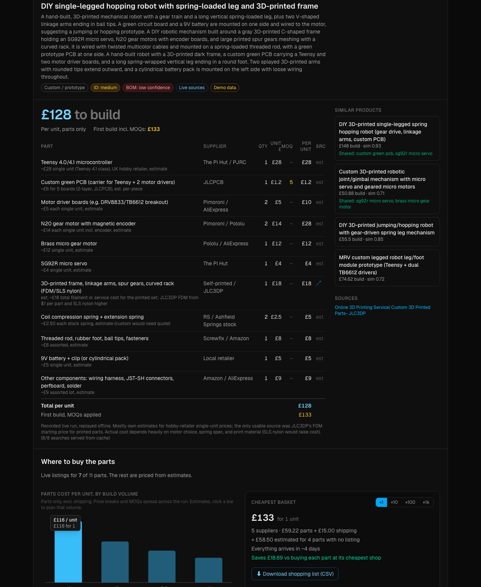

# Teardown

**Photos of any hardware in → bill of materials, build cost, where to buy every part, and how it fits together out.**

Snap a few phone photos of a gadget or a prototype. Teardown identifies it, researches what it's made of, prices every part with a real quantity basis (unit price, MOQ, price breaks), finds live supplier listings, works out the cheapest basket including shipping, and explains how to put it together.

**Live:** https://buildathon-xi-plum.vercel.app · **Instant demo (no upload):** [?demo=robot](https://buildathon-xi-plum.vercel.app/?demo=robot)



Built in one evening at the London Buildathon (MongoDB × Vercel × Tavily).

## What it does

| Step | What happens | Powered by |
|---|---|---|
| **Identify** | All photos go to Claude in one call; it reads chip markings and connectors and returns a structured product + component list | Claude Sonnet 5.5 (vision, structured outputs) |
| **Research + BOM** | Searches teardowns / BOM articles (known products) or each visible component (prototypes); Claude builds the BOM with qty, unit price, MOQ and a price-basis note per line | Tavily + Claude |
| **Where to buy** | Searches UK/maker shops per part, extracts real listings (price, pack size, price breaks, stock) and per-supplier shipping | Tavily + Claude |
| **Cost at volume** | Per-unit parts cost at ×1 / ×10 / ×100 / ×1k with MOQs and price breaks spread across the run | `lib/pricing.ts` |
| **Cheapest basket** | Exhaustive search over supplier combinations, incl. shipping and free-delivery thresholds; CSV shopping list | `lib/pricing.ts` |
| **How it fits together** | Fitting parts (screws, connectors, wire…), build steps, suggested tools, power/data/signal/mechanical connections, missing parts, risks | Claude (vision + BOM) |
| **Similar products** | Every teardown is stored with an embedding; Atlas Vector Search + a shared-parts query surface related teardowns | MongoDB Atlas Vector Search |

### Trust, not vibes

- **No invented links.** Every source or listing URL must appear in the search results Claude was given; anything else is dropped (and counted in a warning).
- **Model reads, code adds up.** Line totals, per-unit vs first-build cost, margins, the volume curve and the basket are all computed in TypeScript, not by the model.
- **Estimates are labelled.** Lines without a source show `est`; BOM confidence drops to *low* when sources don't support the numbers.
- **Partial results.** Each stage fails independently with its own retry; the BOM shows before sourcing and reasoning finish.
- **Fast demos.** Tavily results are cached in MongoDB, and the demo buttons replay a recorded live run fully offline.

## Architecture

```
Browser (Next.js client)
  ├─ POST /api/analyze   photos → product + components           Claude vision
  ├─ POST /api/teardown  product → BOM, totals, similar, stored   Tavily → Claude → MongoDB ($vectorSearch)
  ├─ POST /api/offers    BOM → listings + shipping                Tavily → Claude          ┐ in parallel
  └─ POST /api/assembly  BOM + photos → fitting parts, steps…     Claude vision            ┘
```

- **Claude** is called through the official `@anthropic-ai/sdk` (`messages.parse` + Zod structured outputs). With `ANTHROPIC_API_KEY` set it talks to Anthropic directly; otherwise it is routed through **Vercel AI Gateway** (auth via Vercel OIDC on deploy). See `src/lib/claude.ts`.
- **Embeddings:** `openai/text-embedding-3-small` (1536-d) via Vercel AI Gateway.
- **MongoDB Atlas** collections: `teardowns` (documents + `embedding`, vector index `vec_idx`), `tavily_cache` (unique on query). Indexes are created on first use (`src/lib/db.ts`).

## Run it locally

```bash
pnpm install
cp .env.example .env.local   # then fill in the values below
pnpm dev
```

| Variable | Needed for |
|---|---|
| `MONGODB_URI` | Storage, cache, similar products. Free Atlas M0 works. |
| `TAVILY_API_KEY` | Web research. Optional: without it the SDK runs in keyless mode (shared rate limit). |
| `ANTHROPIC_API_KEY` | Optional: direct Anthropic access. Otherwise use Vercel AI Gateway: `vercel link && vercel env pull` (OIDC token) or set `AI_GATEWAY_API_KEY`. |

Atlas: allow your IP (or `0.0.0.0/0` for Vercel) under Network Access. The vector index is created automatically; for reference its definition is:

```json
{
  "fields": [
    { "type": "vector", "path": "embedding", "numDimensions": 1536, "similarity": "cosine" },
    { "type": "filter", "path": "batchId" }
  ]
}
```

```bash
pnpm test    # pricing / MOQ / basket optimiser unit tests (vitest)
pnpm lint
```

## Limitations

- Prices are estimates unless a line links to a source; shipping and delivery times are typical figures, not quotes.
- Parts with generic names (clone internals, custom PCBs, printed parts) rarely have listings and fall back to estimates.
- A full run makes ~4 model calls and ~10–20 searches; the public demo spends real credits.

## Licence

MIT
