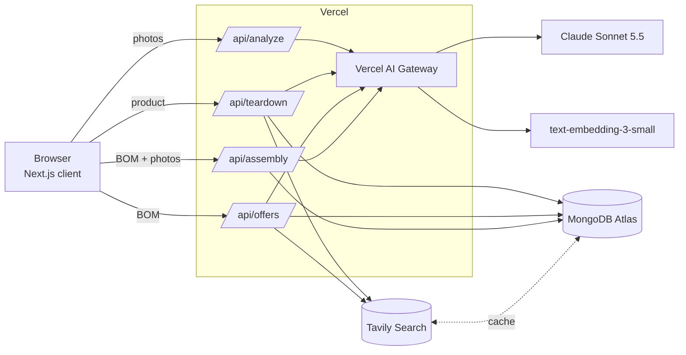
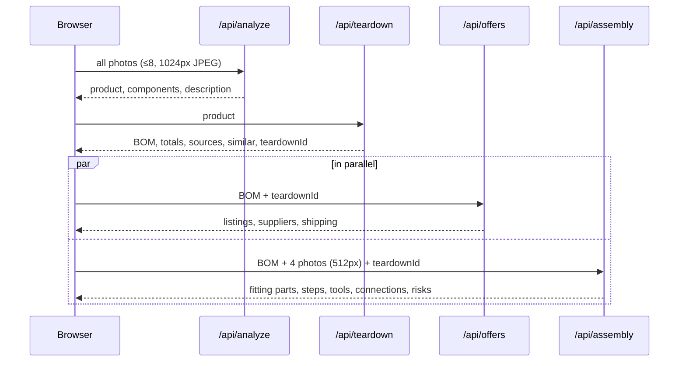

# How Teardown is wired

This page explains every connection in the app: which services it talks to, how it authenticates, what each API route calls, and where data ends up.

## The big picture

The four API routes run as Vercel serverless functions. Each one talks to up to three outside services:

| Service | What we use it for | Code |
|---|---|---|
| **Claude Sonnet 5.5**, via Vercel AI Gateway | Vision (identify, assembly), BOM extraction, listing extraction, engineering reasoning | `src/lib/claude.ts` |
| **OpenAI `text-embedding-3-small`**, via Vercel AI Gateway | 1536-d embeddings for similar-product search | `src/lib/embed.ts` |
| **Tavily Search** | Teardown/BOM articles, component prices, shop listings | `src/lib/tavily.ts` |
| **MongoDB Atlas** | Stores teardowns, vector search, caches Tavily | `src/lib/db.ts`, `src/lib/mongodb.ts` |

## Request flow

One "Tear down" click makes four calls from the browser, in this order:

Basket optimisation, the volume curve and the CSV export run in the browser (`src/lib/pricing.ts`), with no server call.

## Each route, step by step

### `POST /api/analyze`: photos to product
- **In:** `{ images: [{ mediaType, data }] }`, 1–8 base64 JPEGs.
- **Calls:** Claude, once, with all images plus a system prompt. Structured output is validated against the `ImageAnalysis` Zod schema. Effort: `medium`.
- **Out:** `{ product_guess, confidence, is_known_product, visible_components[], description }`
- **Stores:** nothing. Limit: 60 s.

### `POST /api/teardown`: product to BOM
1. **Tavily:** 3 queries for known products (teardown/BOM, cost-to-build, UK price), or one per visible component (up to 8) for prototypes. Each query goes through the Mongo cache.
2. **Claude:** builds the BOM from the numbered sources (`BomExtraction` schema, effort `medium`).
3. **Validation in code:** any `source_url` not in the search results is set to null. Line cost, per-unit total, first-build total (MOQ applied) and margin are calculated in TypeScript.
4. **Embedding:** `"<product>. Parts: …"` goes to the gateway, which returns a 1536-d vector.
5. **Mongo:** `$vectorSearch` on `teardowns.vec_idx`, plus a `parts_norm: { $in }` query, give similar products. Then the teardown is inserted (`insertOne`).
- **Out:** `{ teardown }`, including `id`, which later routes use to update the same document. Limit: 120 s.

### `POST /api/offers`: BOM to where to buy
1. **Tavily:** one query per BOM line, with `includeDomains` set to UK/maker shops in `prefer` mode. For known products it runs two retail queries for the whole product instead. All cached.
2. **Claude:** pulls listings and per-supplier shipping out of the results (`OffersExtraction` schema, effort `low`).
3. **Validation:** listings whose URL isn't in the results, or that have no price, are dropped.
4. **Mongo:** `updateOne($set: { offers })` on the teardown.
- Limit: 120 s.

### `POST /api/assembly`: how it fits together
1. **Claude:** gets the BOM plus up to 4 small photos and returns `Assembly`: summary, fitting parts, build steps, tools, connections, inferred parts, risks. Effort `medium`.
2. **Mongo:** `updateOne($set: { assembly })` on the teardown.
- Limit: 120 s.

### `GET /api/ping`
Runs Mongo `ping` and returns `{ ok: true }` when the database is reachable.

## Authentication

| Connection | How it authenticates | Where the secret lives |
|---|---|---|
| App → Claude (default) | Anthropic SDK pointed at `https://ai-gateway.vercel.sh`, using a **Vercel OIDC token** (`@vercel/oidc`, automatic on Vercel) or `AI_GATEWAY_API_KEY` | Nothing to store on Vercel; locally `vercel env pull` writes `VERCEL_OIDC_TOKEN` to `.env.local` |
| App → Claude (direct) | If `ANTHROPIC_API_KEY` is set, the same SDK talks to Anthropic directly with model id `claude-sonnet-5-5` | Vercel env / `.env.local` |
| App → embeddings | Vercel AI SDK `embedMany` with gateway auth (same OIDC token) | as above |
| App → Tavily | `TAVILY_API_KEY`; without it the SDK runs in **keyless mode** (shared rate limit) | Vercel env / `.env.local` |
| App → MongoDB | `MONGODB_URI` with a database user and password. Uses the standard `mongodb://host1,host2,host3/?replicaSet=…` form, because some networks' DNS breaks `mongodb+srv` lookups | Vercel env / `.env.local` |
| Atlas network | Access list allows `0.0.0.0/0` so Vercel's changing IPs can connect; the database password is the protection | Atlas → Network Access |

`.env.local` is git-ignored; `.env.example` lists the variables with empty values.

## Data in MongoDB

Database: `buildathon`

| Collection | Contents | Indexes |
|---|---|---|
| `teardowns` | One document per live run: product, BOM rows, totals, sources, warnings, `parts_norm[]`, `embedding[1536]`, later `offers` and `assembly` | Atlas Vector Search `vec_idx` (cosine, 1536-d, filter field `batchId`) |
| `tavily_cache` | `{ query, hits[], at }`. The key is the normalised query plus search options | unique `{ query: 1 }` |

Indexes and collections are created on first use (`ensureIndexes()` in `src/lib/db.ts`). Demo mode never touches the database: it replays `src/lib/demo-robot.json` and `src/lib/demo.ts`.

## Deployment

- **Code:** GitHub `termvato/buildathon`, deployed to Vercel project `buildathon` with `vercel deploy --prod`.
- **Vercel env vars:** `MONGODB_URI` and `TAVILY_API_KEY` for production, preview and development. The OIDC token is provided by Vercel at runtime.
- **Atlas:** free M0 cluster `buildathon` on AWS `eu-west-1` (Ireland).
- **Time limits:** `maxDuration` is 60 s for analyze and 120 s for the other routes. A typical full run takes about 40 s end to end.

## Where to change things

| To change… | Edit |
|---|---|
| Claude model / routing | `src/lib/claude.ts` (`MODEL`, gateway vs direct) |
| Embedding model (must stay 1536-d or update the index) | `src/lib/embed.ts`, `EMBED_DIMS` in `src/lib/db.ts` |
| Preferred shops | `SHOPS` in `src/app/api/offers/route.ts` |
| Search depth / result count | `src/lib/tavily.ts` |
| Pricing, MOQ, basket logic | `src/lib/pricing.ts` (tests in `pricing.test.ts`) |
